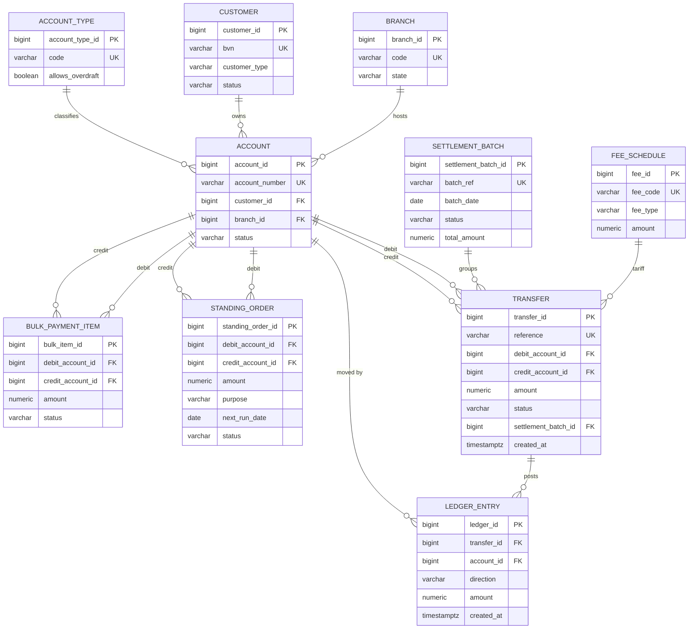

# Advanced Database Systems Portfolio

**Student:** Johnson Kazeem
**Matric:** 2026/A/MIT/0691
**Programme:** MIT, Miva Open University
**Cohort:** September 2026
**Course:** MIT 8103 - Advanced Database Systems
**Database:** `txnbank` (PostgreSQL 16) and `txnbank` (MongoDB 7+)

---

## Case Study: Lagos Meridian Bank - Transaction Banking System

### Organisation

Lagos Meridian Bank (LMB) is a fictional Nigerian commercial bank headquartered on Victoria Island, Lagos. It operates as a mid-tier deposit money bank licensed by the Central Bank of Nigeria (CBN) and offers transaction banking services to retail customers, small businesses and corporate clients. The bank operates a network of branches across Lagos, Abuja, Port Harcourt, Kano and Ibadan, plus an internet banking platform and a USSD short-code channel.

LMB does not issue or store payment cards, does not run a consumer wallet or mobile-money product, and does not hold card numbers, CVV or PIN values anywhere in its systems. Its core product is the movement of Naira between current and savings accounts, both intra-bank (between two LMB accounts) and inter-bank (to other Nigerian deposit money banks via the NIBSS settlement rail).

### Users

The system serves four classes of users:

1. **Retail customers (individuals)** - holders of savings and current accounts who initiate intra-bank and inter-bank transfers, set up standing orders and receive salary credits.
2. **Corporate customers** - limited liability companies and partnerships that run payroll through the bank, maintain current accounts with overdraft facilities, and use bulk salary payment files.
3. **Branch staff** - tellers and operations officers who post transfers over the counter, reverse failed transfers and maintain standing orders on behalf of customers.
4. **Back-office operations** - settlement and reconciliation officers who run settlement batches, apply fee schedules, and quarantine failed transfers for review.

### Data

The relational schema captures ten core entities:

- **branch** - physical bank locations identified by a short code (e.g. `LMB-VI-01`).
- **customer** - individuals and corporates, each with a Bank Verification Number (BVN), contact details and a status.
- **account_type** - product definitions (savings, current, corporate current, capital) with minimum balance and overdraft flags.
- **account** - customer account instances with a unique 10-digit NUBAN-style account number, currency and status (`ACTIVE`, `FROZEN`, `CLOSED`).
- **transfer** - the movement of funds between two accounts, with status (`PENDING`, `SETTLED`, `FAILED`, `REVERSED`), channel and an optional settlement batch link.
- **ledger_entry** - double-entry debit/credit lines that post to accounts; every transfer must have at least one balanced debit and one credit.
- **standing_order** - recurring transfer instructions with a purpose, frequency and next run date.
- **settlement_batch** - groups of transfers settled together, with a total amount and item count.
- **fee_schedule** - tariff definitions (flat or percent) for transfer, maintenance and reversal fees.
- **bulk_payment_item** - per-beneficiary line items inside a corporate salary bulk payment.

Account balances are never typed in directly. They are derived from the ledger (`SUM(credits) - SUM(debits)` per account) and maintained by triggers that are tested against the ledger in Portfolio 1.

### Operations

The bank runs the following transaction banking operations:

1. **Intra-bank transfer** - debit one LMB account, credit another LMB account, both legs booked through `ledger_entry` inside one transaction.
2. **Inter-bank transfer** - debit an LMB account, credit a suspense account pending NIBSS settlement; the credit leg is reversed if the outbound payment fails.
3. **Standing order** - on the next run date the system reads `standing_order` rows where `status = 'ACTIVE'` and `next_run_date <= CURRENT_DATE`, generates a transfer and advances `next_run_date` by the frequency.
4. **Bulk salary payment** - a corporate customer uploads a file of beneficiaries; the bank opens a settlement batch, validates each `bulk_payment_item`, debits the corporate payroll account, and credits each beneficiary account inside a `SAVEPOINT`-guarded loop so that one bad beneficiary row does not roll back the whole batch.
5. **Settlement batch run** - a worker claims `PENDING` transfers from the queue, settles them and updates `settlement_batch`. Two workers may run in parallel; the system must never settle the same transfer twice.
6. **Fee application** - on each settled transfer the matching `fee_schedule` row is applied as a separate debit ledger entry to the debit account.
7. **Reversal** - a `FAILED` transfer is reversed by posting mirror-image ledger entries; a reversal must not create money, so the original debit is reversed with a credit and the original credit with a debit.

---

## Repository Structure

```
advanced-database-portfolio/
├── README.md                              (this file)
├── docs/
│   └── REFERENCES.md
├── portfolio-1-database-design/
│   ├── 01_schema.sql                      tables, keys, constraints, triggers
│   ├── 02_indexes.sql                      FK and report indexes
│   ├── 03_seed_data.sql                    branches, customers, accounts, opening balances
│   ├── 04_bulk_data.sql                    50k+ transfers and 100k+ ledger entries
│   ├── 05_constraint_tests.sql             10 failing tests + 1 control
│   └── README.md
├── portfolio-2-query-optimisation/
│   ├── 01_queries.sql                      8 queries (4 selective, 4 aggregate)
│   ├── 02_explain_analyze.sql              EXPLAIN ANALYZE before/after indexes
│   └── README.md
├── portfolio-3-transactions-concurrency/
│   ├── 01_transactions.sql                 commit, rollback, savepoint demos
│   ├── race_demos.py                       6-part concurrency demonstration
│   └── README.md
├── portfolio-4-nosql/
│   ├── 01_setup.js                         $jsonSchema collections
│   ├── 02_data_and_queries.js              seed + 3 aggregation pipelines
│   ├── 03_bulk_and_index_demo.js           40k docs, COLLSCAN vs IXSCAN
│   └── README.md
└── portfolio-5-distributed-cloud/
    ├── 01_partitioning.sql                 monthly RANGE partition of ledger_entry
    ├── cloud_design.md                     managed DB design, sync/async, NDPA 2023
    └── README.md
```

---

## Entity-Relationship Diagram (key columns only)



---

## How to Run

The project assumes PostgreSQL 16 and MongoDB 7+ installed on a Linux host (GitHub Codespaces), accessed as a non-root user over the Unix socket.

```bash
# PostgreSQL - create the database once
createdb txnbank

# Portfolio 1
psql -d txnbank -v ON_ERROR_STOP=1 -f portfolio-1-database-design/01_schema.sql
psql -d txnbank -v ON_ERROR_STOP=1 -f portfolio-1-database-design/02_indexes.sql
psql -d txnbank -v ON_ERROR_STOP=1 -f portfolio-1-database-design/03_seed_data.sql
psql -d txnbank -v ON_ERROR_STOP=1 -f portfolio-1-database-design/04_bulk_data.sql
psql -d txnbank -v ON_ERROR_STOP=1 -f portfolio-1-database-design/05_constraint_tests.sql

# Portfolio 2
psql -d txnbank -v ON_ERROR_STOP=1 -f portfolio-2-query-optimisation/01_queries.sql
psql -d txnbank -v ON_ERROR_STOP=1 -f portfolio-2-query-optimisation/02_explain_analyze.sql

# Portfolio 3
psql -d txnbank -v ON_ERROR_STOP=1 -f portfolio-3-transactions-concurrency/01_transactions.sql
python3 portfolio-3-transactions-concurrency/race_demos.py

# Portfolio 4
mongosh txnbank portfolio-4-nosql/01_setup.js
mongosh txnbank portfolio-4-nosql/02_data_and_queries.js
mongosh txnbank portfolio-4-nosql/03_bulk_and_index_demo.js

# Portfolio 5
psql -d txnbank -v ON_ERROR_STOP=1 -f portfolio-5-distributed-cloud/01_partitioning.sql
```

The helper scripts `setup.sh`, `runall.sh`, `collect_results.sh`, replica scripts and `pg_basebackup` scripts are provided separately by the student and are intentionally not part of this repository.

---

## AI Use Note

Drafted by GLM (Z.ai); tested and fixed by Claude; run by the student.
